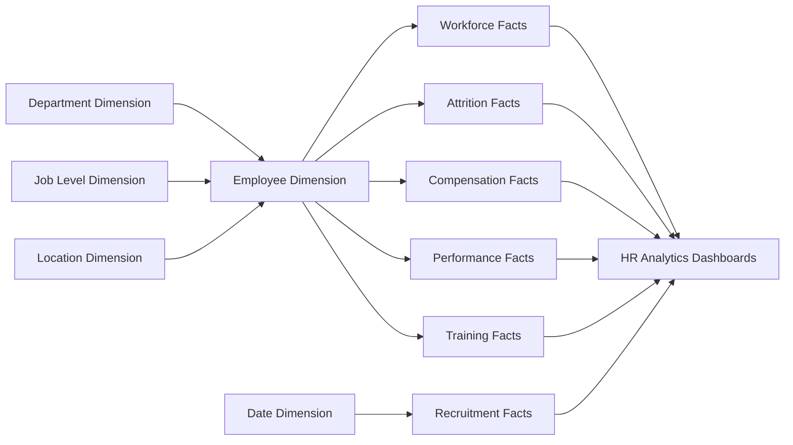
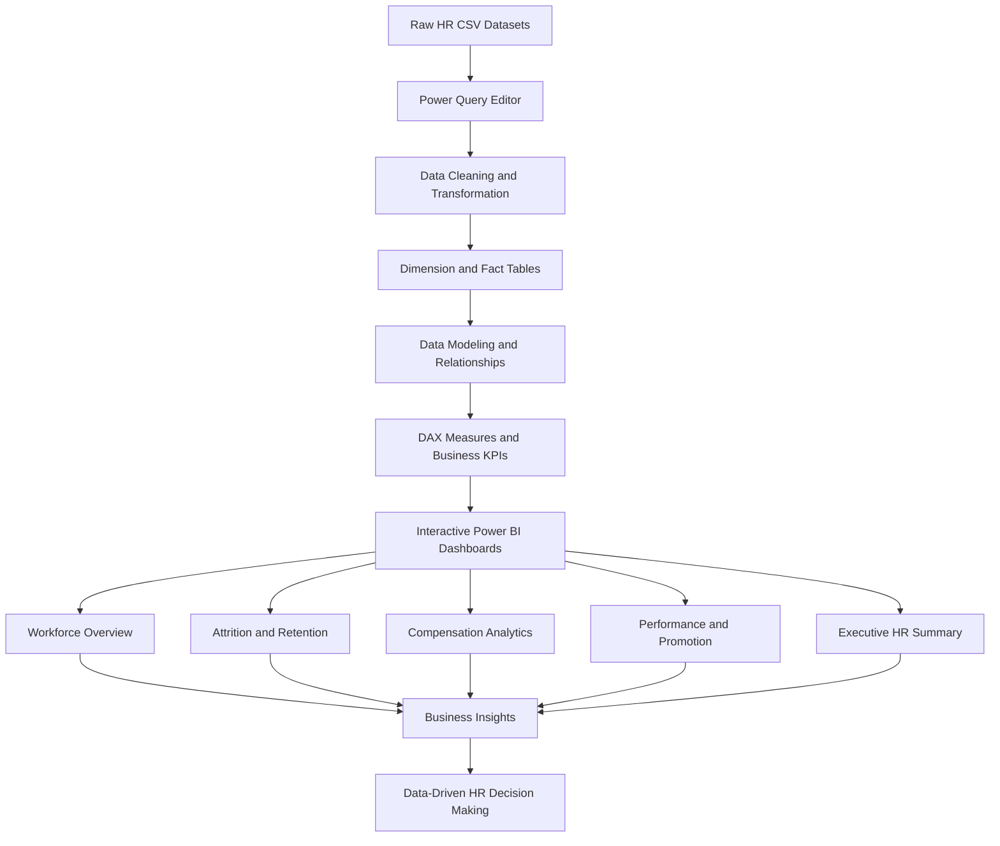

# 🚀 Accenture India — HR & Workforce Analytics Dashboard


> Transforming workforce data into strategic HR intelligence through interactive dashboards, advanced analytics, and actionable business insights.

---

## 📌 Project Overview

The Accenture India HR & Workforce Analytics Dashboard is an end-to-end Business Intelligence project developed using Microsoft Power BI to analyze workforce distribution, employee attrition, compensation, performance, promotions, training, and recruitment activities.

The project integrates 11 structured data tables into a comprehensive analytical solution consisting of five interactive dashboard pages.

By combining Power Query transformations, dimensional data modeling, DAX calculations, geographical analysis, and professional data visualization, this project demonstrates how HR datasets can be transformed into meaningful business intelligence.

---

## 🎯 Business Objectives

- Monitor workforce size and active employee distribution.
- Understand employee demographics and organizational structure.
- Analyze recorded attrition and employee exit reasons.
- Evaluate compensation across departments, locations, and job levels.
- Monitor employee performance and promotion activity.
- Analyze training completion and workforce development.
- Identify high-performing employees and departments.
- Understand recruitment activity and candidate stage distribution.
- Enable geographical workforce analysis.
- Provide consolidated executive-level HR reporting.
- Support data-driven workforce planning and talent management.

---

## 📊 Executive KPI Summary

| Key Performance Indicator | Dashboard Value |
|:---|---:|
| 👥 Total Employees | 50,000 |
| ✅ Active Employees | 48,006 |
| 📉 Employees with Attrition Records | 8,000 |
| 🔄 Recorded Attrition Ratio | 16.0% |
| 🛡️ Active Workforce Percentage | 96.0% |
| 📅 Average Tenure | 10.3 Years |
| ⚖️ Gender Ratio (Male : Female) | 61 : 39 |
| 💰 Total Compensation | ₹16,529.69 Cr |
| 💵 Average Salary | ₹31.45 LPA |
| 🏆 Highest Salary | ₹60.00 LPA |
| 📊 Median Salary | ₹31.34 LPA |
| ⭐ Average Performance Rating | 3.6 / 5 |
| 📈 Promoted Employees | 12,260 |
| 🚀 Recorded Promotion Rate | 24.5% |
| 🏅 High Performers | 22,659 |
| 🎓 Training Completion Rate | 92.0% |
| 🌍 Geographic Coverage | 12 Indian Cities |
| 🗂️ Source Data Tables | 11 |
| 🧮 DAX Measures | 57 |
| 🖥️ Interactive Dashboard Pages | 5 |
| 📅 Recruitment Data As Of | 31-Dec-2025 |

---

## 🖥️ Dashboard Navigation

| Page | Dashboard | Analytical Focus |
|:---:|:---|:---|
| 01 | [Workforce Overview](#-dashboard-1--workforce-overview) | Employee Distribution and Workforce Composition |
| 02 | [Attrition & Retention](#-dashboard-2--attrition--retention-analysis) | Recorded Attrition and Employee Status |
| 03 | [Compensation Analytics](#-dashboard-3--compensation--salary-analytics) | Workforce Cost and Salary Distribution |
| 04 | [Performance & Promotion](#-dashboard-4--performance--promotion-analytics) | Talent Development and Learning Effectiveness |
| 05 | [Executive HR Summary](#-dashboard-5--executive-hr-summary) | Consolidated Strategic HR Indicators |

---

# 👥 Dashboard 1 — Workforce Overview


## Dashboard Overview

The Workforce Overview dashboard provides a comprehensive analytical view of employee distribution, workforce demographics, departmental headcount, geographical concentration, and recruitment activity.

### Key Performance Indicators

- Total Employees
- Active Employees
- Recorded Attrition Ratio
- Average Tenure
- Gender Ratio

### Dashboard Visualizations

- Employee Distribution by Department
- Employee Distribution by Location
- Workforce Composition by Gender
- Monthly Recruitment Activity
- Workforce Summary by Department and Job Level
- Dynamic Key Insights

### Interactive Filters

- Recruitment Year
- Recruitment Quarter
- Department
- City
- Job Level
- Gender
- Clear Filters Button

### 💡 Key Business Insights

- The dataset contains 50,000 employees across multiple organizational departments.
- Approximately 48,006 employees are classified as active.
- The active workforce represents approximately 96% of total employees.
- Male employees account for approximately 60.78% of the workforce.
- Female employees account for approximately 39.22% of the workforce.
- SAP leads departmental workforce size.
- Bengaluru has the highest employee concentration.
- Average employee tenure is approximately 10.3 years.
- Average employee experience is approximately 12.8 years.

### Business Value

This dashboard supports workforce planning, resource allocation, employee demographic analysis, departmental staffing assessment, and recruitment monitoring.

---

# 🔄 Dashboard 2 — Attrition & Retention Analysis


## Dashboard Overview

The Attrition & Retention dashboard analyzes recorded employee attrition, workforce status, attrition reasons, job-level distribution, gender composition, and geographical employee exit patterns.

### Key Performance Indicators

- Total Attritions
- Recorded Attrition Ratio
- Active Workforce Percentage
- Average Tenure

### Dashboard Visualizations

- Attrition by Department
- Attrition by Job Level
- Recorded Attrition Reasons
- Attrition by Gender
- Geographic Attrition Distribution
- Recorded Exits by Department
- Department-Level Attrition Detail
- Dynamic Key Insights

### Interactive Filters

- Department
- City
- Job Level
- Gender
- Clear Filters Button

### Recorded Attrition Reasons

| Attrition Reason | Recorded Employees |
|:---|---:|
| Better Salary | 1,636 |
| Relocation | 1,634 |
| Career Growth | 1,616 |
| Personal Reasons | 1,588 |
| Work Life Balance | 1,526 |
| **Total** | **8,000** |

### 💡 Key Business Insights

- A total of 8,000 employees have recorded attrition information.
- The recorded attrition ratio stands at 16%.
- Better Salary is the most frequently recorded attrition reason.
- Relocation and Career Growth are also prominent recorded reasons.
- SAP leads departmental recorded attrition.
- Male employees account for approximately 60.19% of recorded attrition cases.
- The average workforce tenure is 10.3 years.
- The active workforce percentage stands at approximately 96%.

### Business Value

This dashboard supports employee retention research, compensation competitiveness assessment, career development planning, and identification of workforce segments requiring further investigation.

### Analytical Note

The recorded attrition ratio is not an annual employee turnover rate. Employee exit dates are unavailable in the source dataset, and recorded attrition information is not equivalent to current inactive employee status.

---

# 💰 Dashboard 3 — Compensation & Salary Analytics


## Dashboard Overview

The Compensation & Salary Analytics dashboard evaluates workforce costs, salary distribution, departmental compensation, job-level salary differences, employee experience, and geographical salary patterns.

### Key Performance Indicators

- Total Compensation
- Average Salary
- Highest Salary
- Median Salary
- Employees Covered

### Dashboard Visualizations

- Salary Distribution by LPA Bands
- Average Salary by Department
- Average Salary by Job Level
- Average Experience by Department
- Salary by Location
- Average Salary by Gender
- Compensation Summary by Department and Job Level
- Dynamic Key Insights

### Interactive Filters

- Department
- Job Level
- City
- Gender
- Clear Filters Button

### 💡 Key Business Insights

- Total recorded compensation amounts to ₹16,529.69 crore.
- Average employee salary is ₹31.45 LPA.
- Median employee salary is ₹31.34 LPA.
- The highest recorded salary is ₹60.00 LPA.
- The minimum recorded salary is ₹3.00 LPA.
- Compensation analysis covers 50,000 employees.
- Strategy leads departmental average salary.
- Kolkata has the highest average salary among recorded cities.
- Average male salary is approximately ₹31.50 LPA.
- Average female salary is approximately ₹31.36 LPA.

### Business Value

This dashboard supports compensation benchmarking, workforce cost monitoring, salary planning, departmental comparisons, and preliminary pay-equity analysis.

Gender-based salary averages should not be interpreted as a definitive pay-equity assessment without controlling for job level, role, experience, and other relevant factors.

---

# 🏆 Dashboard 4 — Performance & Promotion Analytics


## Dashboard Overview

The Performance & Promotion Analytics dashboard evaluates workforce performance ratings, employee promotions, high-performing talent, training participation, and learning effectiveness.

### Key Performance Indicators

- Average Performance Rating
- Promotion Rate
- High Performers
- Training Completion Percentage

### Dashboard Visualizations

- Performance Rating Distribution
- Promotions by Department
- Training Completion Analysis
- Performance by Location
- Promotions by Job Level
- Talent Scorecard by Department and Job Level
- Dynamic Key Insights

### Interactive Filters

- Department
- City
- Job Level
- Gender
- Clear Filters Button

### 💡 Key Business Insights

- The average performance rating is approximately 3.6 out of 5.
- A total of 12,260 employees are recorded as promoted.
- The recorded promotion rate stands at approximately 24.5%.
- A total of 22,659 employees are classified as high performers.
- Training completion stands at approximately 92%.
- The dashboard represents approximately 250,000 training records.
- Technology leads the recorded promotion rate.
- Bengaluru has the highest number of high-performing employees.

### Business Value

This dashboard supports talent management, employee recognition, promotion planning, learning and development, and departmental performance assessment.

Performance and promotion indicators represent recorded dataset activity rather than verified annual performance measures.

---

# 📋 Dashboard 5 — Executive HR Summary


## Dashboard Overview

The Executive HR Summary dashboard consolidates essential workforce, compensation, attrition, promotion, training, and recruitment indicators into a unified strategic reporting interface.

### Key Performance Indicators

- Total Employees
- Recorded Attrition Ratio
- Average Salary
- Promotion Rate
- High Performers

### Dashboard Visualizations

- Recruitment Stage Distribution
- Compensation by Department — Treemap
- Recorded Attrition Ratio by Department
- Geographic Employee Distribution
- Department HR Scorecard
- Executive Key Insights

### Executive HR Highlights

| Analytical Area | Recorded Performance |
|:---|---:|
| Workforce Size | 50,000 |
| Recorded Attrition Ratio | 16.0% |
| Average Salary | ₹31.45 LPA |
| Recorded Promotion Rate | 24.5% |
| High Performers | 22,659 |
| Training Completion | 92.0% |

### Recruitment Stage Analysis

| Recruitment Stage | Approximate Candidate Count |
|:---|---:|
| Applied | 270,000 |
| Interviewed | 110,000 |
| Offered | 50,000 |
| Joined | 40,000 |
| Retained | 30,000 |

The stage counts are rounded dashboard values.

The visualization represents recruitment stage distribution rather than a verified sequential conversion funnel because the dataset does not establish that the same candidate cohort progressed through each stage.

### 💡 Executive Insights

- Workforce headcount stands at 50,000 employees.
- Recorded attrition represents 16% of total employees.
- Average salary stands at ₹31.45 LPA.
- Recorded promotion rate is approximately 24.5%.
- The dataset identifies 22,659 high performers.
- Training completion remains strong at approximately 92%.

### Business Value

The executive dashboard provides a consolidated view of organizational workforce indicators, supporting strategic HR reporting, workforce planning, talent development, and management-level decision-making.

---

## 🛠️ Tools & Technologies

| Technology | Application |
|:---|:---|
| Microsoft Power BI Desktop | Interactive Dashboard Development |
| Power Query | Data Cleaning and Transformation |
| DAX | Business Metrics and Advanced Calculations |
| Data Modeling | Dimension and Fact Table Relationships |
| CSV Datasets | Source Data |
| Geographic Maps | Location-Based Workforce Analysis |
| Matrix Visuals | Hierarchical HR Reporting |
| GitHub | Project Documentation and Portfolio |

---

## 🗂️ Dataset Architecture

The project integrates 11 structured HR data tables organized into dimension and fact tables.

### Dimension Tables

| Table Name | Description |
|:---|:---|
| DimDate | Calendar and Date Information |
| DimDepartment | Organizational Department Information |
| DimEmployee | Employee Details and Demographics |
| DimJobLevel | Employee Job-Level Classification |
| DimLocation | City and Location Information |

### Fact Tables

| Table Name | Description |
|:---|:---|
| FactWorkforce | Workforce and Employee Status Records |
| FactAttrition | Recorded Employee Attrition Information |
| FactCompensation | Salary and Compensation Records |
| FactPerformance | Performance and Promotion Records |
| FactRecruitment | Candidate and Recruitment Activity |
| FactTraining | Employee Training Records |

---

## 🧹 Data Cleaning & Transformation

Data preparation was performed using Power Query Editor to organize the source datasets and prepare them for analytical reporting.

### Data Preparation Workflow

- Importing source CSV datasets
- Reviewing dataset structure and data quality
- Configuring appropriate column data types
- Preparing employee and organizational attributes
- Organizing numerical and categorical fields
- Preparing recruitment date information
- Preparing dimension and fact tables
- Preserving Power Query Applied Steps
- Preparing geographical location fields
- Supporting salary-band classification
- Preparing datasets for relational data modeling

---

## 🔗 Data Modeling & Relationships

The project incorporates dimensional data modeling to support interactive analysis across multiple HR subject areas.

### Modeling Capabilities

- Employee ID-based relationships
- Department-level filtering
- Job-level segmentation
- Location-based analysis
- Recruitment date filtering
- Relationship-based aggregation
- Dynamic filter context
- Cross-visual interactions
- Department and job-level drill-down
- Context-aware KPI calculations

### Conceptual Data Model



This diagram illustrates the conceptual analytical architecture rather than every physical relationship in the Power BI semantic model.

---

## 🧮 DAX Measures & Business Calculations

The project incorporates 57 DAX measures to calculate workforce indicators, compensation metrics, employee performance, recruitment activity, and dynamic business insights.

### Workforce Analytics Measures

- Total Employees
- Active Employees
- Active Workforce Percentage
- Average Tenure
- Average Experience
- Male Employees
- Female Employees
- Gender Ratio
- Workforce Share Percentage

### Attrition Analytics Measures

- Total Attritions
- Recorded Attrition Ratio
- Department-Level Attrition
- Leading Attrition Department
- Leading Recorded Attrition Reason

### Compensation Analytics Measures

- Total Compensation
- Total Compensation in Crores
- Average Salary in LPA
- Median Salary in LPA
- Maximum Salary in LPA
- Minimum Salary in LPA
- Employees with Salary Records

### Performance Analytics Measures

- Average Performance Rating
- Rated Employees
- Promoted Employees
- Promotion Rate
- High Performers
- Training Completion Rate
- Total Training Records

### Recruitment & Executive Measures

- Total Candidates
- Recruitment Activity
- Candidate Stage Distribution
- Dynamic Recruitment Reporting Date
- Department HR Indicators
- Dynamic Key Insights

---

## 📐 Core Business Calculation Logic

### Total Employees

Total Employees = Distinct Count of Employee IDs

### Active Workforce Percentage

Active Workforce % = Active Employees / Total Employees × 100

### Recorded Attrition Ratio

Recorded Attrition Ratio = Employees with Attrition Records / Total Employees × 100

8,000 / 50,000 × 100 = 16%

### Promotion Rate

Promotion Rate = Promoted Employees / Rated Employees × 100

### Training Completion Rate

Training Completion % = Completed Training Records / Total Training Records × 100

### Average Salary

Average Salary = Average of Recorded Current Salary

### Salary in Lakhs Per Annum

Salary LPA = Annual Salary Amount / 100,000

### Compensation in Crores

Compensation Cr = Total Compensation Amount / 10,000,000

### Workforce Share

Workforce Share % = Employees in Selected Group / Total Employees in Relevant Context × 100

These formulas describe the business calculation logic used in the analytical dashboards.

---

## 🌍 Geographic Workforce Analytics

Interactive geographic maps provide visibility into workforce indicators across 12 Indian cities.

### Geographic Analysis Includes

- Employee Distribution by Location
- Recorded Attrition by Location
- Average Salary by Location
- High Performers by Location
- Executive Workforce Distribution

### Cities Covered

| City | City | City |
|:---|:---|:---|
| Bengaluru | Hyderabad | Mumbai |
| Pune | Gurugram | Noida |
| Kolkata | Chennai | Ahmedabad |
| Jaipur | Kochi | Indore |

The maps use city-wise colored bubbles with metric-based bubble sizes, enabling geographical comparisons across different HR analytical areas.

---

## ⚙️ End-to-End Project Workflow



---

## 🎨 Dashboard Design & User Experience

The project features a consistent professional visual identity inspired by Accenture's corporate branding.

### Design Highlights

- Accenture-inspired purple, black, and white color palette
- Corporate-style logo and branding
- Professional dashboard headers
- Five-page navigation sidebar
- Architectural background illustrations
- Custom HR-themed KPI icons
- Consistent card-based dashboard layouts
- Interactive dropdown slicers
- Select All filtering options
- Clear Filters buttons
- Dynamic recruitment reporting date
- Indian currency formatting
- Multi-colored geographical bubble maps
- Interactive matrix visualizations
- Department and job-level hierarchies
- Dynamic Key Insights panels
- Consistent typography and spacing

### Color Palette

| Color | Hex Code | Usage |
|:---|:---:|:---|
| Accenture Purple | `#7500C0` | Primary Branding |
| Deep Purple | `#460099` | Charts and Highlights |
| Dark Navy | `#0B1020` | Navigation Sidebar |
| White | `#FFFFFF` | Dashboard Cards |
| Light Grey | `#F5F5FA` | Dashboard Background |

The palette describes the project's visual direction.

---

## 🧭 Interactive Features

### Dynamic Filtering

Users can explore applicable HR metrics through the following slicers:

- Department
- City
- Job Level
- Gender
- Recruitment Year
- Recruitment Quarter

Recruitment Year and Quarter filters apply specifically to recruitment-related data.

### Page Navigation

Custom sidebar navigation buttons connect all five dashboard pages, enabling users to move between analytical sections.

### Clear Filters

Dedicated Clear Filters buttons reset applicable dashboard slicer selections.

### Cross-Visual Interactions

Supported slicers update related KPI cards, charts, maps, matrices, and dynamic insights according to the model's filter relationships.

### Hierarchical Analysis

Department and job-level matrices provide detailed workforce, compensation, and performance comparisons.

---

## 💡 Strategic Business Recommendations

### 1. Strengthen Employee Retention Strategies

Investigate recorded attrition reasons such as salary expectations, relocation, and career growth to identify opportunities for improving employee engagement and retention.

### 2. Improve Compensation Benchmarking

Evaluate salary differences across departments, job levels, and locations to support competitive compensation planning.

### 3. Strengthen Career Development Programs

Analyze promotion distribution and performance ratings to identify employee development opportunities.

### 4. Enhance Learning and Development

Maintain the strong recorded training completion rate of approximately 92% while investigating incomplete training records.

### 5. Recognize High-Performing Talent

Explore the 22,659 recorded high performers to identify opportunities for employee recognition and leadership development.

### 6. Optimize Geographic Workforce Planning

Evaluate employee concentration across Indian cities to support location-based staffing and operational planning.

### 7. Improve Recruitment Monitoring

Analyze monthly recruitment activity and candidate stage distribution. Candidate-level longitudinal tracking would enable stronger recruitment conversion analysis.

### 8. Strengthen Department-Level Performance Monitoring

Use the Department HR Scorecard to compare recorded attrition, average salary, performance ratings, promotion activity, and training completion.

---

## 🚀 Skills Demonstrated

- Business Intelligence
- Human Resource Analytics
- Workforce Analytics
- Data Analysis
- Data Cleaning
- Data Transformation
- Power Query
- Dimensional Data Modeling
- Relational Database Concepts
- DAX Calculations
- Business KPI Development
- Employee Attrition Analysis
- Compensation Analytics
- Salary Distribution Analysis
- Performance Analytics
- Promotion Analytics
- Talent Management
- Recruitment Analytics
- Training Analytics
- Geographical Data Analysis
- Interactive Dashboard Development
- Data Visualization
- Business Storytelling
- Executive Reporting
- GitHub Documentation

---

## 📂 Project Structure

```text
📦 ACCENTURE-DATA-ANALYTICS-POWERBI
│
├── 📁 ASSETS/
│   ├── 🖼️ WORKFORCE OVERVIEW DASHBOARD.png
│   ├── 🖼️ ATTRITION & RETENTION ANALYSIS.png
│   ├── 🖼️ COMPENSATION & SALARY ANALYTICS.png
│   ├── 🖼️ PERFORMANCE & PROMOTION ANALYTICS.png
│   └── 🖼️ EXECUTIVE HR SUMMARY DASHBOARD.png
│
├── 📁 DATASETS/
│   └── 📦 DATASETS.ZIP
│
├── 📊 ACCENTURE_DATA_ANALYTICS.pbix
│
└── 📄 README.md
```

---

## 📥 How to Use This Project

1. Clone or download this GitHub repository.
2. Install Microsoft Power BI Desktop.
3. Extract the source datasets if provided as a ZIP archive.
4. Open the Power BI PBIX report file.
5. Explore all five interactive dashboard pages.
6. Apply Department, City, Job Level, and Gender filters.
7. Use recruitment-related filters to explore candidate activity.
8. Analyze KPI cards, charts, geographic maps, and matrices.
9. Use Clear Filters to reset dashboard selections.
10. Navigate between pages using the custom sidebar.

Refreshing the project may require updating the original CSV source file paths.

Geographic maps may require an internet connection and enabled Power BI map settings.

---

## 📋 Analytical Scope & Dataset Limitations

This project is developed using the available educational HR dataset.

To ensure transparent and responsible analytical reporting, the following limitations are acknowledged:

- The 16% recorded attrition ratio is not an annual employee turnover rate.
- Employee exit dates are unavailable.
- Recorded attrition information and active employee status represent different dataset attributes.
- Active workforce percentage is not equivalent to an annual retention rate.
- Recruitment Year and Quarter filters apply to recruitment-related data.
- Historical workforce comparisons are not included where historical information is unavailable.
- Salary calculations assume annual INR salary amounts.
- Promotion indicators represent recorded promotion activity rather than verified annual promotion rates.
- Training completion is calculated at the training-record level.
- Recruitment stage distribution does not establish sequential candidate conversion rates.
- The dashboard does not represent official Accenture workforce statistics.

---

## 🏆 Project Outcome

The Accenture India HR & Workforce Analytics project demonstrates the practical application of Microsoft Power BI in transforming structured HR datasets into a comprehensive, interactive Business Intelligence reporting solution.

The project integrates five major analytical dimensions:

- 👥 Workforce Overview
- 🔄 Attrition & Retention
- 💰 Compensation & Salary Analytics
- 🏆 Performance & Promotion Analytics
- 📋 Executive HR Summary

By combining 11 structured data tables, 57 DAX measures, interactive visualizations, geographical analysis, and executive-level business reporting, the project demonstrates a practical approach to HR analytics and data-driven organizational decision-making.

---

## 🔗 Project Repository

[Explore Accenture HR & Workforce Analytics on GitHub](https://github.com/raki265-official-ai/ACCENTURE-DATA-ANALYTICS-POWERBI)

---

## 📢 Disclaimer

This project was developed for educational, learning, and data analytics portfolio purposes with AI-assisted dashboard development.

It is not an official Accenture report and is not affiliated with, endorsed by, or commissioned by Accenture.

Company names, logos, and branding elements are used for demonstration purposes only.

All reported metrics and business insights are based on the educational dataset used in this project and should not be interpreted as actual Accenture financial or workforce disclosures.

---

## ⭐ Support

If you found this project insightful or useful, consider giving this repository a star.

---

<div align="center">

### 🚀 Transforming Workforce Data into Strategic Intelligence

**Data Analytics | Business Intelligence | Power BI | DAX | HR Analytics**

**Explore Data. Discover Insights. Drive Decisions.**

</div>
